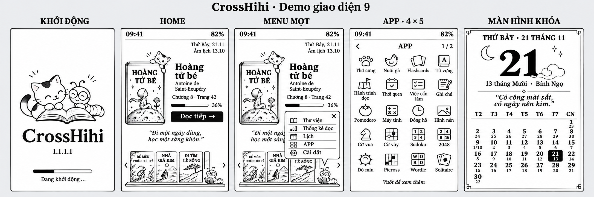

# CrossHihi 1.1.1.1

Firmware dành riêng cho **Xteink X4 Pro (ESP32-S3)**, phát triển từ CrossNext-VN 2.0.4-vn.1.

**Bản thử công khai:** mã cần vượt qua build X4 Pro và kiểm thử máy tính trước khi phát hành. Chưa có kết quả đo pin, cảm ứng hay ngủ/thức trên thiết bị thật; không coi hình demo là ảnh chụp thiết bị.

## Giao diện



*Ảnh trên là demo thiết kế, không phải ảnh chạy firmware. Danh sách APP trong ảnh là minh họa. Mã thực tế giữ danh mục app/game của CrossNext-VN; menu Mọt có thêm Truyền tệp. Linh vật trong firmware dùng nét vẽ riêng bằng các hình cơ bản, không phải ảnh bitmap lấy nguyên từ demo.*

- Logo khởi động Mọt + Mèo, tên **CrossHihi**, phiên bản **1.1.1.1**.
- Home cố định: sách đang đọc lớn, châm ngôn hai dòng ở giữa, kệ sách vuốt ở dưới cùng.
- Chạm bìa hoặc thông tin sách chính để đọc tiếp. Chạm sách trên kệ để mở; vuốt để duyệt tiếp thư viện đã lập chỉ mục.
- Mèo có năm tư thế/biểu cảm, đổi khi vào Home; chạm mèo để đổi tư thế. Không chạy hoạt ảnh liên tục.
- Mọt ngồi cố định ở đầu kệ. Popup là lớp phủ, không đẩy châm ngôn hay linh vật.
- Menu Mọt: **Thư viện · Thống kê đọc · Lịch · APP · Truyền tệp · Cài đặt**. Nút Confirm trên Home cũng mở menu khi chưa chọn mục; Back đóng popup.
- APP gộp toàn bộ app và game đang có thành lưới **4 cột × 5 hàng**, vuốt sang trang. Dữ liệu lưu và định danh app/game cũ được giữ. Nhấn giữ một mục trong APP để đưa lên đầu danh sách.
- Tự ngủ khi đang đọc: giữ trang sách. Bấm nguồn chủ động: hiện lịch khóa.
- Home và khóa không còn lựa chọn kiểu bố cục; cài đặt font/cỡ chữ/lề đọc sách vẫn còn.

## Linh vật từ mã thực tế


Ảnh này xuất trực tiếp từ hàm vẽ linh vật dùng trong firmware; không phải ảnh chụp màn hình máy đọc.

## Tiếng Việt và English

Chọn trong **Cài đặt → Hệ thống → Ngôn ngữ**; xác nhận để khởi động lại.

- **Tiếng Việt:** châm ngôn tiếng Việt, ngày âm ở Home và lịch khóa có ngày âm dưới ngày dương; có năm Can Chi.
- **English:** châm ngôn tiếng Anh, ẩn toàn bộ lịch âm ở cả Home và khóa. Lịch dương và điều hướng dùng tiếng Anh.
- Khi chưa đặt được ngày giờ, màn hình khóa yêu cầu đặt giờ, không tạo ngày âm giả.

## Truyền tệp bằng QR

Mở **Mọt → Truyền tệp**. Chọn kết nối Wi-Fi hoặc phát hotspot, chờ máy chủ sẵn sàng rồi quét mã QR. Điện thoại phải ở đúng mạng. Đây là chức năng truyền tệp web kế thừa, không phải dịch vụ đám mây mới.

## Cài đặt và cập nhật

1. Sao lưu toàn bộ microSD, đặc biệt thư mục ẩn `/.crosspoint/` và dữ liệu app.
2. Tải gói **CrossHihi-X4Pro-v1.1.1.1.zip** trong [Releases](https://github.com/MrZen287/CrossNext-VN/releases).
3. Chép firmware `.bin` và tài nguyên vào thẻ, giữ nguyên các giấy phép. Không xóa `/.crosspoint/`.
4. Trên X4 Pro có trình cập nhật qua microSD tương thích, vào **Cài đặt → Hệ thống → Cập nhật firmware** và chọn tệp `.bin`.

Tệp **CrossHihi-X4PRO-OTA.bin** là firmware ứng dụng cho X4 Pro, không phải ảnh factory hay bootloader. Không dùng cho X3/X4 thường hoặc thay bảng phân vùng. Gói này không thay đổi phân vùng; máy phải có slot ứng dụng đủ lớn.

**OTA:** vào **Cài đặt → Hệ thống → Kiểm tra cập nhật**. Nguồn cập nhật trỏ về repo này, nhận đúng asset CrossHihi và so sánh đủ bốn phần phiên bản. Tài nguyên SD cần cập nhật riêng nếu ghi chú bản phát hành yêu cầu.

## Dung lượng bản build

Build X4 Pro sau tối ưu dùng **7.647.142 / 8.323.072 byte (91,9%)** ngân sách ứng dụng; giảm khoảng **255 KiB** so với bản đầu. Hai kiểu chữ hiển thị rất lớn trong app dùng chung cỡ 28, không cắt bộ ký tự hay đổi font đọc sách. Đây là dung lượng flash, không phải mức RAM khi chạy.

## Phát triển và kiểm chứng

```sh
pip install git+https://github.com/pioarduino/platformio-core.git
pip install -r requirements.txt
sh host-tests/crosshihi/run.sh
pio run -e gh_release_x4pro
```

Xem [ghi chú bản 1.1.1.1](docs/crosshihi/release-1.1.1.1.md) và [các app được giữ](docs/crosshihi/apps.md).

## Nguồn và giấy phép

CrossHihi kế thừa [CrossNext-VN](https://github.com/MrZen287/CrossNext-VN), [CrossNext](https://github.com/manuelx900/CrossNext), [CrossPlay](https://github.com/ma-r-s/crossplay), [CrossPoint](https://github.com/crosspoint-reader/crosspoint-reader) và FreeInk SDK. Giữ [LICENSE](LICENSE), [THIRD-PARTY-NOTICES.md](THIRD-PARTY-NOTICES.md), giấy phép SDK, font và tài nguyên. Đổi thương hiệu trong giao diện không loại bỏ ghi nhận nguồn và giấy phép kế thừa.
