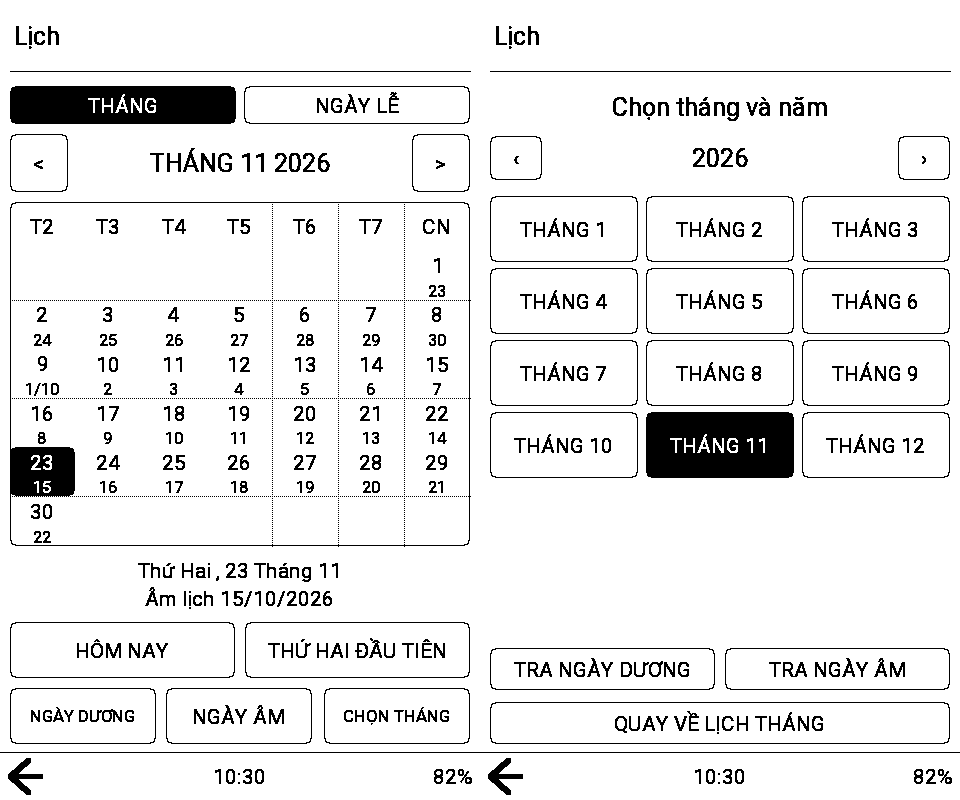
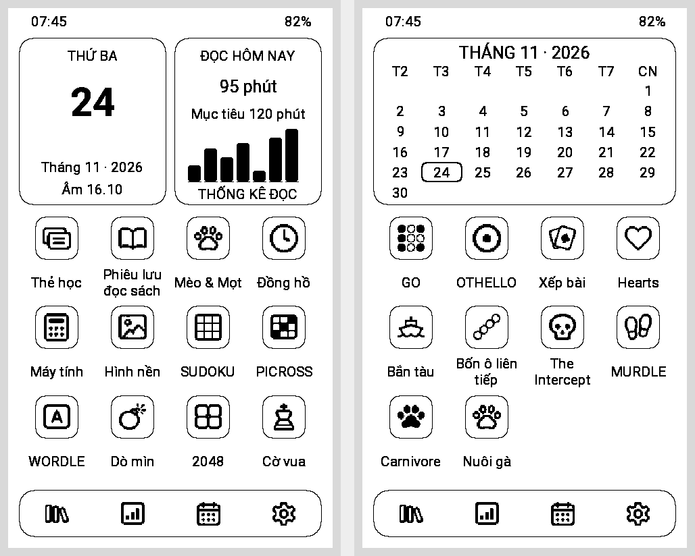
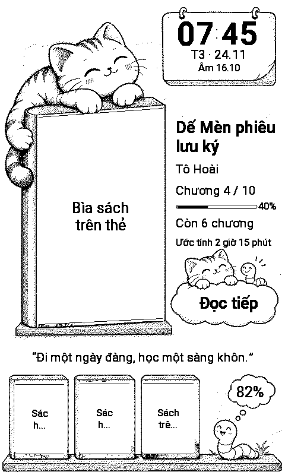

# CrossZen 1.1.1.10

Firmware tiếng Việt dành riêng cho **Xteink X4 Pro (ESP32-S3)**. Phát triển từ CrossNext-VN/CrossPoint/CrossPlay; giữ giấy phép và ghi công trong [THIRD-PARTY-NOTICES.md](THIRD-PARTY-NOTICES.md).

[Ghi chú phát hành Việt / English](docs/crosshihi/release-1.1.1.10.md) · [Tải bản thử nghiệm](https://github.com/MrZen287/CrossNext-VN/releases/tag/v1.1.1.10)

## Thay đổi chính

- Home có đồng hồ/ngày âm–dương trong khung nhỏ góc phải, pin trong bóng suy nghĩ của Mọt, nút Đọc tiếp dạng mây. Giữ mèo ôm bìa sách cố định và kệ sách ở dưới.
- Vuốt trái ngoài kệ mở **Thư viện**, vuốt phải mở **APP**; vuốt trong kệ chuyển sách. Mọt mở Thống kê đọc, Lịch, Truyền tệp và Cài đặt.
- Thư viện mở **Tất cả** thay cho chỉ Gần đây. Quét sâu tối đa 16 cấp; còn giới hạn 4096 bản ghi và các định dạng đọc được.
- Các thanh điều khiển dùng chung có nền trắng, nút Back/giờ/% pin ở dưới; bảng kéo xuống có nút tròn. Bỏ các đường chọn phong cách Home.
- Lịch khóa dạng tờ giấy, có nhánh lá/đồng ruộng/mái nhà quanh số ngày; không giờ/pin. Có thể chọn ảnh PNG/BMP cá nhân.
- Tự ngủ từ trình đọc giữ trang, thêm hình mèo–mọt đọc sách; bấm nguồn chủ động mở màn khóa.
- Bốn tab thống kê dùng biểu đồ/thanh so sánh từ dữ liệu đọc thật; vẫn mở được chi tiết sách/lịch sử.
- Lịch có chọn tháng/năm, ngày lễ, tra âm–dương và tờ lịch ngày khi chạm ngày. Dữ liệu lịch dân gian ngoại tuyến **2026–2028**; [nguồn và quy ước](docs/crosshihi/almanac.md).
- **400 câu tiếng Việt từ 7 từ trở lên**, chọn theo chiều rộng font để vừa một dòng. Không còn lựa chọn giao diện tiếng Anh.
- Giữ app Mèo–Mọt hiện tại; bỏ Cờ đam, còn **23 app/game**. Không thêm bộ chạy ứng dụng của firmware gốc.

## Ảnh dựng từ mã giao diện

Ảnh dựng trên máy tính từ mã giao diện và font/asset được nhúng; số liệu minh họa, không phải ảnh chụp máy thật. Hình minh họa khóa được đóng gói trong firmware, không cần chép ảnh riêng lên thẻ.

## Cập nhật

- **OTA:** sau khi bản phát hành và manifest sẵn sàng, mở **Mọt → Cài đặt → Kiểm tra cập nhật**. Tệp `CrossHihi-X4PRO-OTA.bin` được giữ cho các bản cũ, có cùng nội dung với `CrossZen-X4PRO-OTA.bin`.
- **Từ microSD:** chép `CrossZen-X4Pro-v1.1.1.10.bin` lên thẻ, vào **Cài đặt → Thiết bị → Cập nhật chương trình cơ sở**, chọn tệp và xác nhận.
- Từ 1.1.1.4 không cần chép lại tài nguyên SD. Giữ dữ liệu và thư mục ẩn. Gói ZIP đầy đủ vẫn kèm tài nguyên gốc và giấy phép.
- Đây là ảnh **ứng dụng X4 Pro**, không phải factory/bootloader, không thay bảng phân vùng và không dùng cho X3/X4 thường.

## Giới hạn đã biết

Chưa đo cảm ứng, bóng mờ, pin và OTA đầu-cuối trên máy thật. Bộ đọc EPUB chưa nạp font nhúng qua `@font-face`; không kèm Bookerly, vẫn dùng font có sẵn/đã cài trên thẻ. Đường chấm dưới dòng áp dụng cho EPUB. Dữ liệu tốt/xấu là cách ghi theo lịch dân gian, không phải đánh giá chung cho mọi việc hay từng người; ngoài 2026–2028 vẫn xem được âm–dương nhưng không hiện phần dân gian chưa có. Cần đúng ngày giờ trên máy để lịch và thống kê theo ngày hoạt động chính xác.

## English

Experimental **X4 Pro only** firmware, with a **Vietnamese-only device UI**. [Bilingual release notes](docs/crosshihi/release-1.1.1.10.md) describe the Home/navigation redesign, white bottom controls, illustrated calendar lock, real-data statistics charts, offline 2026–2028 almanac, 400 fitted Vietnamese sayings and removal of Checkers. The existing Cat/Worm game and save data remain.

The images above are host renders using the interface code and embedded assets/fonts, with sample data. They are not physical-device photos. Update with the existing firmware updater after release publication or install the versioned application `.bin` through the existing X4 Pro microSD updater. Previous 1.1.1.4 SD resources do not need to be recopied. Legacy and current OTA aliases are byte-identical.

Embedded EPUB fonts and bundled Bookerly are not included. Physical-device touch, ghosting, battery and end-to-end OTA remain unmeasured. See [almanac methodology](docs/crosshihi/almanac.md) and retained third-party notices for source and licensing details.

### Home thứ hai / Second Home

Vuốt lên từ Home có mèo. Chạm widget để mở Lịch hoặc Thống kê đọc; vuốt trái để xem lịch tháng và trang app tiếp theo. Dock: Thư viện · Thống kê · Lịch · Cài đặt. Không có thanh navigation. Hình dưới được dựng từ bộ vẽ giao diện với dữ liệu minh họa; danh sách app trong hình minh họa không phải ảnh chụp thiết bị.

## Bản 1.1.1.10

Sửa nền đen trong Thư viện Tất cả; đổi widget theo từng ô; đồng hồ vuông; Home có thông tin chương, phần trăm, chương còn lại và thời gian ước tính; bật/tắt dòng kẻ EPUB với 5 kiểu. Font đọc Bokerlam từ thẻ, hệ thống Roboto. Xem ghi chú phát hành để chuẩn bị font trước OTA.

### Home mèo 3D · 1.1.1.10

Hình mèo ôm sách cố định, bệ đỡ sách và kệ gỗ từ mẫu đã duyệt được nhúng ở 480×800; bìa/tên sách và thống kê vẫn là dữ liệu thực. Chạm châm ngôn một lần để đổi câu. Ảnh dưới dựng từ bộ vẽ firmware với bìa giữ chỗ và dữ liệu minh họa.

Từ Điển Anh–Việt / Việt–Anh cần gói dữ liệu SD đi kèm bản phát hành. [Thay đổi và cách cài 1.1.1.10](docs/crosshihi/release-1.1.1.10.md).
