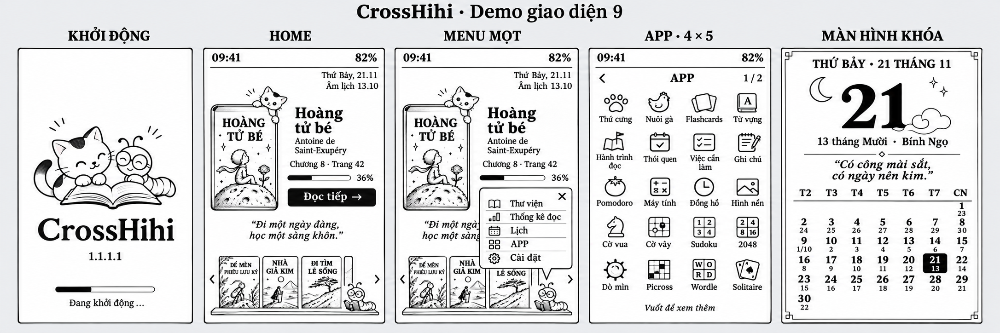
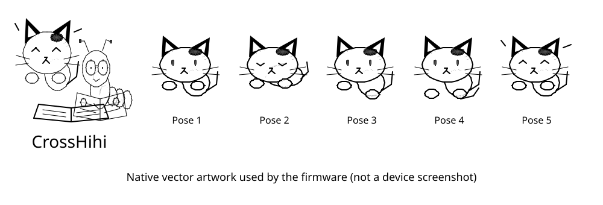

# CrossHihi 1.1.1.1 — bản thử công khai cho Xteink X4 Pro

Giao diện Home và lịch khóa mới theo demo đã thống nhất, logo Mọt + Mèo, APP gộp dạng lưới 4 × 5 và hai ngôn ngữ Việt/Anh.

**Đây là ảnh demo ý tưởng, không phải ảnh chụp firmware.** Bản chạy dùng linh vật nét đơn giản từ mã, menu có thêm Truyền tệp. APP giữ nguyên các mục đã đăng ký trong bản CrossNext-VN gốc, không thêm những app chỉ xuất hiện trong hình minh họa.

Linh vật ở hình trên được xuất từ hàm vẽ trong mã, không phải screenshot thiết bị.

## Hành vi

- Mọt không đổi vị trí khi popup mở; nội dung phía sau không đổi bố cục.
- Menu gồm Thư viện, Thống kê đọc, Lịch, APP, Truyền tệp, Cài đặt.
- Mèo có năm tư thế, đổi khi vào Home hoặc được chạm; đứng yên giữa các tương tác.
- Kệ nhớ trang đang duyệt trong cùng phiên chạy và chỉ giữ một trang sách/bìa trong RAM.
- Tự ngủ từ trình đọc giữ trang; ngủ chủ động hiện lịch khóa cố định.
- English có kho câu tiếng Anh và không hiển thị ngày âm ở Home/khóa.
- OTA nhận đúng tên firmware CrossHihi, so sánh phiên bản bốn phần. Cập nhật qua SD vẫn có.
- Giữ dữ liệu sách, app và game; không đổi đường dẫn `/.crosspoint/`.

## Cài đặt

Sao lưu thẻ. Chép `.bin` và tài nguyên vào microSD, rồi cập nhật từ trình cập nhật X4 Pro tương thích. Không chép ảnh factory vào trình cập nhật ứng dụng. Không cài lên X3/X4 thường. Không xóa thư mục dữ liệu ẩn.

## Dung lượng

Flash ứng dụng: **7.647.142 / 8.323.072 byte (91,9%)**, giảm khoảng 255 KiB từ bản đầu 95,0%. Đã bỏ đường dựng theme cũ và dùng chung cỡ 28 cho hai kiểu chữ rất lớn trong app; font đọc sách và bộ ký tự được giữ. Không suy diễn tỷ lệ flash thành mức dùng RAM hay tốc độ.

## Kiểm chứng và giới hạn

Kết quả build và kiểm thử được đính kèm trong gói phát hành. Kiểm tra trên máy tính không xác nhận chất lượng màn e-ink, độ nhạy cảm ứng, QR trên điện thoại, OTA xuyên suốt, hao pin hay ngủ/thức trên X4 Pro thật. Cần thử các luồng này trên thiết bị trước khi coi là bản ổn định.

Gói tài nguyên kế thừa bản CrossNext-VN 2.0.4-vn.1, giữ giấy phép. Mèo/Mọt/đường kẻ được vẽ từ mã, không cần thêm gói hình SD riêng.
