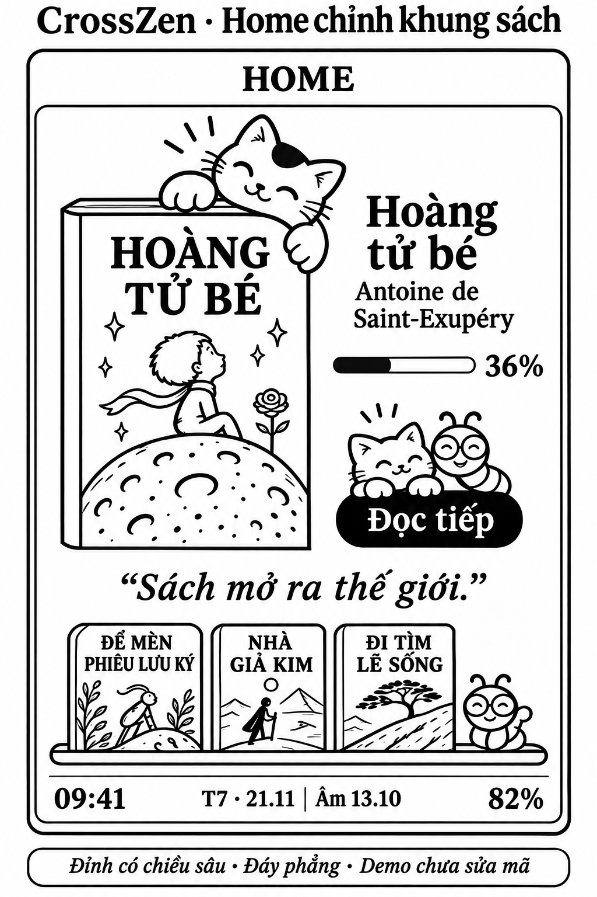

# CrossZen 1.1.1.3 — bản thử cho Xteink X4 Pro

Đổi tên CrossHihi thành CrossZen; giữ nguyên dữ liệu sách và 24 ứng dụng/game.

Ảnh trên là demo thiết kế, không phải ảnh chụp thiết bị. Màn chọn ảnh trong firmware dùng danh sách và trình duyệt thư mục PNG/BMP; chưa có khung xem trước như hình ý tưởng.

## Thay đổi

- Home có bìa sách lớn, mèo lớn ôm bìa; hình ôm góc dùng bộ nét riêng. Cụm Mèo–Mọt nhỏ ôm nút **Đọc tiếp**, bỏ mũi tên.
- Một hàng status dưới: giờ, thứ/ngày dương và ngày âm, % pin. English ẩn ngày âm.
- Châm ngôn chỉ một dòng, lọc bằng chiều rộng font thực tế. Khi mở popup, câu và bố cục nền giữ nguyên.
- Chạm Mọt mở popup sát phía trên, đổi biểu cảm mà không đổi vị trí. Popup được phép che nội dung phía trên.
- APP 4×5, 24 mục ở hai trang, sắp xếp tiện ích/đọc trước rồi game. Không có nhấn giữ để ghim icon.
- Lịch khóa chỉ tên thứ trên cùng, số ngày lớn, dòng âm lịch; bỏ trăng/sao/mèo. Hai cột cuối tuần đậm hơn.
- **Cài đặt → Hiển thị → Màn hình khóa:** Lịch hoặc Ảnh từ thư mục. Chọn một ảnh PNG/BMP từ bất kỳ thư mục trên SD. Ảnh mất/hỏng quay về lịch; không xóa ảnh gốc. Ảnh được chuyển đen trắng khi hiển thị.
- Tự ngủ khi đang đọc vẫn giữ trang; bấm nguồn chủ động dùng lịch hoặc ảnh đã chọn.
- Giữ 24 mục APP; **Thú cưng** được thay bằng chế độ mới chuyển thể Book Pet. Không còn tùy chọn mở chế độ thú cũ. Không xóa thư mục dữ liệu cũ trên SD.
- Thú mới có ba loài Byte/Mote/Pip, cho ăn, vệ sinh, nghỉ/thức, chơi nhớ vị trí, mua thức ăn, mở thú/đồ chơi và nhật ký. Thưởng, kinh nghiệm và mở khóa từ chăm sóc/chơi, **không phụ thuộc đọc sách**; không đọc kho thống kê đọc. Tiến trình lưu riêng trong NVS, không dùng dữ liệu thú cũ.
- Không thêm hẹn giờ/sổ trích dẫn. Đồng bộ statusbar sang toàn bộ Cài đặt/trình đọc để đợt sau.

## Cập nhật OTA từ CrossHihi

Từ 1.1.1.1/1.1.1.2: **Mọt → Cài đặt → Hệ thống → Kiểm tra cập nhật**, kết nối Wi-Fi rồi xác nhận 1.1.1.3. OTA chỉ cập nhật firmware; không cần chép lại tài nguyên đang có. Asset `CrossHihi-X4PRO-OTA.bin` được giữ làm tên tương thích cho máy cũ, nội dung là CrossZen mới, giống hệt `CrossZen-X4PRO-OTA.bin`.

Ảnh khóa tự chọn phải có sẵn trên thẻ. Chép qua thẻ hoặc **Mọt → Truyền tệp**, sau đó chọn trong cài đặt. Không cần tải lại toàn bộ gói tài nguyên chỉ để đổi ảnh.

Cài qua SD: dùng `CrossZen-X4Pro-v1.1.1.3.bin` với trình cập nhật ứng dụng X4 Pro tương thích. Chỉ dùng cho X4 Pro, không phải ảnh factory. Sao lưu SD trước khi cập nhật, giữ thư mục ẩn `/.crosspoint/`. Gói ZIP kèm tài nguyên kế thừa được cung cấp cho cài mới.

## Kiểm chứng

Build X4 Pro, kiểm thử máy tính và kiểm tra ảnh ESP được chạy trước khi phát hành. Chưa có thiết bị thật để kiểm tra cảm ứng, ghosting, pin, ngủ/thức hoặc OTA xuyên suốt. Đây là bản thử công khai. Xem log build đính kèm để biết dung lượng flash/RAM tĩnh; không suy diễn flash thành mức dùng RAM lúc chạy.

Giữ LICENSE và các ghi nhận nguồn kế thừa. Các sprite CrossZen được tạo riêng, nhúng thành mask ink/silhouette để không xóa hình chữ nhật quanh mèo. Các định danh nội bộ `.crosspoint` và tên branch `crosshihi` giữ nguyên nhằm tương thích dữ liệu/OTA.

## Nguồn chế độ thú mới

Chuyển thể lõi chăm sóc, lưu trạng thái và sprite từ [Book Pet](https://github.com/unipheas/book-pet-x3), MIT, ©2026 Brian Phillips và cộng tác viên. Đã thay lớp hiển thị/điều khiển để chạy trong CrossZen X4 Pro, bỏ engine thưởng đọc sách, đổi mở khóa sang chăm sóc/chơi, dùng vùng lưu `crosszen-pet`. Không dùng bootloader, bảng phân vùng hoặc trình cập nhật X3. Giấy phép đầy đủ: `licenses/BookPet-MIT.txt`. Hình thú trong bản chạy là pixel-art Byte/Mote/Pip từ dự án gốc; hình mèo trong demo trước là ý tưởng thiết kế, chưa phải ảnh giao diện game thực tế.

---

# English — CrossZen 1.1.1.3 · Xteink X4 Pro preview

CrossHihi is now CrossZen. This release keeps the existing book data and 24 APP entries. The screenshots above are design concepts, not photographs or device screenshots.

## Changes

- Home: larger current-book cover and cover-hugging cat; a smaller cat/worm pair hugs the Continue button. The arrow has been removed.
- One bottom status row contains the time, compact date and battery percentage. Vietnamese also shows the lunar date; English hides lunar dates on Home and the calendar lock screen.
- Quotes are selected to fit one line using the actual font width. Opening the menu does not move the background content or the shelf worm. The worm changes expression; its popup stays immediately above it.
- APP keeps a 4-column, 5-row grid, with reading/tools first and games next. All 24 entries remain. There is no long-press pinning action.
- Calendar lock: weekday-only heading, large day number, no moon/stars/cat; weekend columns have stronger text weight.
- Settings → Display → Lock screen offers Calendar or Image from folder. Choose one PNG/BMP anywhere on the SD card. Invalid or missing images fall back to the calendar. Images are rendered in black and white. The actual picker uses a file list, without the concept demo's thumbnail preview.
- Automatic sleep from the reader preserves the page. Deliberate power-button sleep shows the chosen calendar/image lock.
- The old virtual pet mode is replaced by a Book Pet adaptation with Byte/Mote/Pip, feeding, cleaning, rest/wake, a position-memory minigame, food purchases, species/toy unlocks and a diary. Growth, rewards and unlocks come from CARE AND PLAY, NOT READING. It does not read the reading-statistics store. Progress uses its own NVS namespace; old SD pet saves remain untouched but are not imported.
- No reading timer or quote notebook has been added. Consistent bottom status bars throughout the other settings/reader screens are deferred.

## OTA upgrade from CrossHihi

On 1.1.1.1 or 1.1.1.2, open Worm → Settings → System → Check for updates, connect to Wi-Fi, and confirm 1.1.1.3. No SD resource recopy is required for this update. The legacy `CrossHihi-X4PRO-OTA.bin` filename remains as an upgrade-compatible alias; it contains the same CrossZen firmware as `CrossZen-X4PRO-OTA.bin`.

Your selected lock image must already be on the SD card. Copy it through the card or the existing QR/web File transfer, then select it in Lock screen settings.

For an SD update, select `CrossZen-X4Pro-v1.1.1.3.bin` in a compatible X4 Pro application updater. This is not a factory image. Back up the card and preserve `/.crosspoint/`. Only install on X4 Pro. A full resource ZIP is provided for fresh installations.

## Validation and licensing

The release workflow builds for X4 Pro, runs Home/version/catalog and Book Pet care/game/growth/save-restore host tests, and verifies the ESP image before publication. Flash/static RAM usage is in the attached build log. No physical device is connected: touch, e-ink ghosting, battery life, sleep/wake and end-to-end OTA still require hardware testing. This is a public prerelease.

Book Pet care/state code and original pixel sprites are adapted from https://github.com/unipheas/book-pet-x3 under MIT (©2026 Brian Phillips and Book Pet contributors); see `licenses/BookPet-MIT.txt`. The X3 bootloader, partition table, updater and reading-reward engine are not used. Existing project/SDK/font/resource licenses and acknowledgements are preserved.
