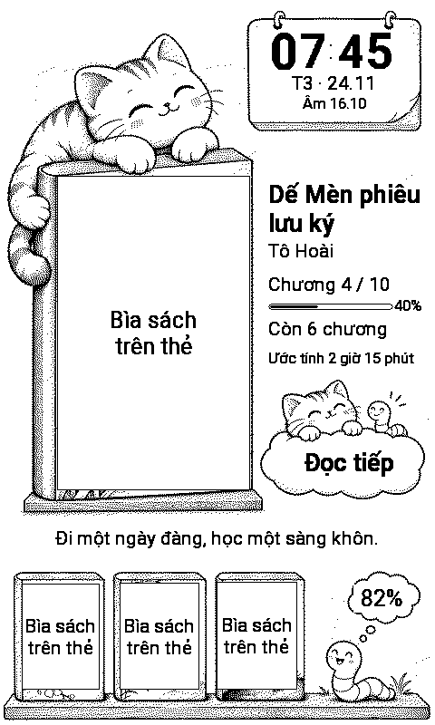

# CrossZen 1.1.1.8 — Home mèo 3D / X4 Pro

## Tiếng Việt

- Nhúng nét vẽ mèo ôm sách, khung lịch, bệ đỡ sách, nút Đọc tiếp và kệ gỗ từ bản thiết kế đã duyệt. Tài nguyên 480×800 được chuyển đen trắng để hiển thị trực tiếp trên X4 Pro.
- Mèo giữ cố định tư thế ôm sách. Không đổi tư thế khi vào Home, bấm mèo hoặc mở menu Mọt.
- Chạm vào dòng châm ngôn một lần để đổi câu. Khi popup Mọt mở, thao tác ngoài popup chỉ đóng popup, không kích hoạt nội dung bên dưới.
- Ba bìa sách và Mọt cùng đặt trên kệ gỗ; sách đang đọc có bệ riêng. Mọt và popup giữ vị trí cố định, menu vẫn gồm Thống kê đọc, Lịch, Truyền tệp, Cài đặt.
- Bìa, tên sách, tác giả, chương, tiến độ, ước tính thời gian, đồng hồ, ngày và pin lấy từ dữ liệu thực. Bìa được co vào khung cố định; vì vậy các nội dung này thay đổi theo sách/máy, không phải một ảnh mẫu bất biến.
- Giữ các tính năng của 1.1.1.7: tùy chọn widget, dòng kẻ EPUB 5 kiểu/bật tắt, vuốt mép chỉnh đèn, sửa Thư viện, thống kê, lịch và app/game.

### Cập nhật

Vào Cài đặt → Kiểm tra cập nhật hoặc cài file .bin qua mục cập nhật từ thẻ. Bản này chỉ cho Xteink X4 Pro. Không cần chép lại tài nguyên hình Home: đã nằm trong firmware. Giữ nguyên dữ liệu và **/fonts/Bokerlam/** trên thẻ; font đọc từ gói nội bộ trước không nằm trong OTA/công khai. Thiếu font sẽ dùng dự phòng. Không đổi font ảnh XTC.

Đã kiểm tra vùng bấm, popup, châm ngôn, bố cục và ảnh dựng 1-bit 480×800; kiểm tra build và ảnh ESP32-S3. Chưa kiểm tra cảm ứng, bóng mờ, tốc độ hiển thị và OTA đầu-cuối trên máy thật. Chi tiết nét và số liệu thực có thể khác ảnh thiết kế.

## English

X4 Pro only. Embeds the approved 480×800 monochrome Cat Home artwork: fixed hugging kitten, book pedestal, wooden shelf shared by the small books and worm, calendar frame and Continue cloud. Tap the quote once to change it. Opening the worm popup does not move the worm or change the kitten pose.

Book covers and all reading/time/battery information remain live, fitted into the fixed artwork. The native preview uses placeholder covers and sample data; the screen is not a hard-coded screenshot. Existing 1.1.1.7 apps, storage and controls remain. Home artwork is embedded, so no new SD image files are required. Preserve /fonts/Bokerlam/ from the earlier private font bundle. Firmware, host interaction and ESP integrity checks are performed; physical-device rendering, ghosting and end-to-end OTA are not verified.
