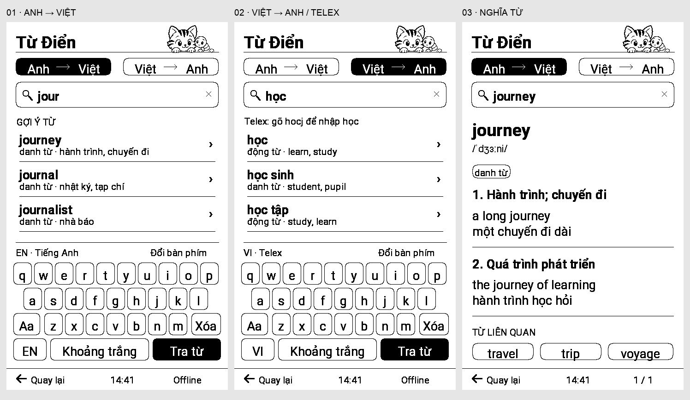
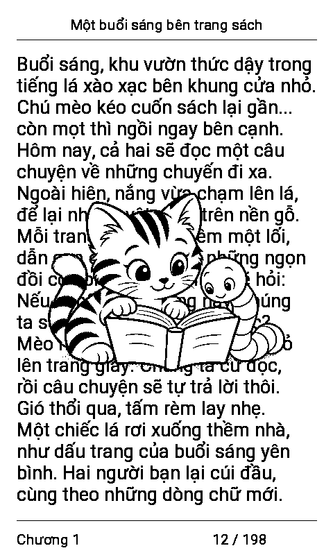

# CrossZen 1.1.1.9 — Xteink X4 Pro

## Tiếng Việt

- Từ Điển Anh → Việt / Việt → Anh độc lập, tra offline, gợi ý tiền tố và bàn phím Telex. Mèo và mọt bám đường kẻ cạnh tiêu đề. **Cần chép gói dữ liệu SD một lần**; OTA không thêm file vào thẻ.
- Gói từ điển: **371.705 mục Anh–Việt** sau chuẩn hóa/gộp trùng từ 372.200 headword gốc FVDP (không lấy nguồn AI), **54.274 mục Việt–Anh** từ VNEDICT của Paul Denisowski. Đây là mục từ/cụm từ, không phải số từ đơn. Ghi công và giấy phép đi kèm ZIP.
- Vuốt phải ngoài kệ từ Home mèo mở Từ Điển; vuốt trái mở APP. Thư viện trở lại popup mọt, vẫn có trong dock Home thứ hai. Vuốt trên kệ tiếp tục lật các sách trên kệ.
- Gỡ lối tra từ/dịch và chọn từ điển khỏi trình đọc/Cài đặt; app từ điển hoạt động riêng. Giữ nguyên các app/game đang có.
- Nút Home: một lần về Home mèo ở các màn hình khác; ở trang đọc, bấm đơn sang trang tiếp, bấm đôi về Home mèo, giữ mở chỉnh chữ. Bấm đơn trong trình đọc chờ khoảng 350ms để phân biệt bấm đôi. Màn hình USB đang chia sẻ thẻ vẫn phải kết thúc chia sẻ trước khi điều hướng.
- Bìa sách ép vào bốn góc mặt bìa 3D, cắt tại khung và vẽ lại chân mèo phía trước. Khắc phục lệch tọa độ do mép an toàn màn hình. Chữ Home được căn lại; châm ngôn hạ nhẹ và đặt trong ngoặc kép.
- Giữ tư thế mèo ôm sách, đổi sáu biểu cảm khi chạm hoặc quay lại Home; vân lông rõ hơn.
- Dòng kẻ EPUB theo font thực tế từng dòng, nằm dưới nét chữ và trước dòng tiếp theo; bật/tắt, chấm mảnh/đậm, gạch ngắn, gạch chấm, nét liền. Tên tùy chọn không dùng ký tự gạch Unicode bị thiếu font; mẫu vẽ bằng pixel.
- Tự ngủ giữ trang sách với mèo và mọt lớn ở giữa, nền ngoài hình trong suốt, bóng chấm nhẹ. Bấm nguồn chủ động hiện lịch khóa. Lịch thêm chi tiết, mặt trời phía trên bên phải, mép giấy xé đậm và có bóng.

### Cài trên máy đã có CrossZen/CrossHihi

1. Giữ sách và font `/fonts/Bokerlam/` đang dùng. File app `.bin` không phải bộ full-flash bootloader.
2. Cập nhật OTA trong máy hoặc cài `CrossZen-X4Pro-v1.1.1.9.bin` theo cách cài app firmware hiện tại.
3. Giải nén `CrossZen-Tu-Dien-Anh-Viet.zip` vào gốc thẻ nhớ để có `/dictionaries/CrossZen/`. Thực hiện một lần, các lần OTA sau giữ nguyên dữ liệu này.
4. APP → Từ Điển, hoặc vuốt phải từ Home mèo. Chạm gợi ý để mở nghĩa; chạm ô tìm kiếm để sửa; vuốt ngang/nhấn phím cạnh để chuyển trang nghĩa.

Bộ dữ liệu đặt trên thẻ, không nhúng hàng chục MB vào firmware/RAM. Các câu nghĩa/ví dụ hiển thị theo nguồn; không phải mục nào cũng có phiên âm hoặc ví dụ như dữ liệu demo. Bộ Bokerlam do người dùng cung cấp không có giấy phép phân phối công khai nên không được đóng lại trong bản phát hành.

### Kiểm tra

Build ESP32-S3 X4 Pro, xác minh board tag, kích thước phân vùng, checksum ESP và SHA-256. Kiểm tra Telex, tìm tiền tố/tra nghĩa trên dữ liệu thật cả hai chiều, vị trí dòng kẻ, cắt mặt bìa và các hồi quy Home/Thư viện/BookPet. Preview dùng khung hình 1-bit 480×800. Chưa chạy thử trên thiết bị vật lý; độ phản hồi/e-ink ghosting và hiển thị thực tế cần xác nhận trên máy.

Nguồn: [FVDP mirror](https://github.com/tecxmate/vnme-data), [VNEDICT StarDict](https://github.com/cer28/stardict-vnedict), [Paul Denisowski](http://www.denisowski.org/Vietnamese/vnedict_readme.htm). Công cụ chuyển đổi và checksum nguồn được ghi trong manifest dữ liệu.

## English release notes

CrossZen 1.1.1.9 is an X4 Pro firmware release with a **Vietnamese interface**. It adds a standalone offline English–Vietnamese / Vietnamese–English dictionary, prefix suggestions, and Vietnamese Telex input. The separate SD data pack contains 371,705 normalized English–Vietnamese entries from the GPL FVDP subset (AI records excluded), plus 54,274 Vietnamese–English entries from Paul Denisowski's CC BY 3.0 VNEDICT. Install the data pack once at the SD root; firmware OTA does not write SD resources.

Swipe right outside the book shelf opens Dictionary; swipe left opens APP. Library is back in the worm popup and remains in the second Home dock. Reader lookup/translation settings and entry points are removed. All existing apps/games remain. Home key: one tap returns to Cat Home outside reading; in the reader, single tap advances a page (350ms double-tap detection), double tap opens Cat Home, hold opens text settings. Active USB card sharing must be ended before navigation.

Also fixes cover coordinates with bezel insets, maps covers into the illustrated 3D face, preserves foreground paws, aligns Home copy, adds fixed-pose facial expressions, strengthens fur detail, places EPUB reading guides using actual per-line font metrics, replaces unsupported guide label glyphs with drawn samples, enlarges transparent idle companions, and enhances the calendar paper illustration and torn edge.

Keep existing `/fonts/Bokerlam/` SD fonts. User-provided fonts lack redistribution metadata and are not redistributed publicly. App BINs are not bootloader/full-flash images. Build, ESP image checks and host regressions are verified; physical-device behavior is not yet verified. Dictionary content and availability of IPA/examples depend on the source rather than demo sample text.
